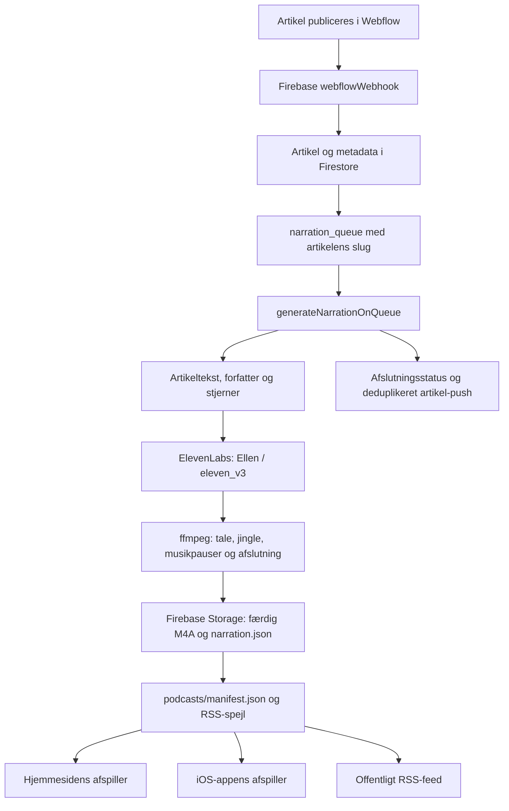

# Artikel til automatisk lydepisode

## Ellen v4 aktiveret til nye lydartikler 31. oktober kl. 12:32

Efter ejerens valg af v4-prøven er den eksisterende lydworker opdateret med
`eleven_v4`. Google afsluttede den afgrænsede kildeopdatering kl. 11:32:18 UTC.
Den aktive, sunde revision er `generatenarrationonqueue-00011-nog` med 100 %
trafik. Frisk readback kl. 11:33:24 UTC har verificeret alle 13 kildefiler mod
den testede pakke, SHA-256
`00e2482e98f71d2d18e66ff32fbc3cede2d268ccd7725008ac221b385ea90f72`.
Kun `narration.js` og `narrationAudioRecipe.cjs` er ændret. Én fælles modelkonstant
styrer både provideranmodninger og episoderne gemte modelmetadata.

V.2-jinglen er frisk aflæst som det gemte valg, revision 1, kl. 11:34:04 UTC.
Næste nye lydartikel bruger dermed Ellen/v4 med den nye V.2-jingle, seks sekunders
intro med originalens naturlige overgang, det aftalte beatniveau, ingen indsatte
tresekunders musikpauser og den længere afslutning om gratis lytning uden reklamer
og forstyrrelser. Voice-ID, dansk, stability 1 og episode-seed følger den godkendte
v4-prøve. Eksisterende chunkgrænse og talehastighed bevares.

Alle 25 målrettede hermetiske kontroller består, inklusive flere v4-chunks,
korrekte modelmetadata, komplet afslutning, virkelig FFmpeg-mix, V.1/V.2-valg,
kvotestop, providerfejl og genbrug af en allerede indtalt artikel. En lokal mixprøve
med den bevarede virkelige v4-indtaling og V.2-jinglen er desuden fuldt dekodet:
43,78 sekunder, peak -5,2 dB. Ingen nye providerkald i denne aktivering.

Runtime, trigger, secrets, skalering, timeout, memory, retry og øvrige servicefelter
matcher førtilstanden; konfigurationshash
`0b102584f558a9131054fbce018ac02cc3a2d5eaacf168181be08fba9e7639ae`.
Budget, 80 %-kvotestop og alle oprindelige musikassets er bevaret. De 130
eksisterende RSS-episoders GUID/lyd-URL-par er identiske før og efter. Ingen
artikel, køjob eller gammel episode er publiceret eller genindspillet for at
demonstrere aktiveringen. Første reelle nye artikels v4-episode skal fortsat
verificeres efter ejerens normale publicering.

Evidens: `output/narration-v4-release-20261031/production-evidence.zip`,
`production-verified.json`, `candidate-verification.json`, `tests.tap`,
`rebuilt-exact-verification.json`, `v4-jingle-mix-validation.json`,
`jingle-after.json`, `rss-preservation.json` og `cloud-run-v4-active.jpg`.
Den tidligere aktive v3-kilde/revision 10 er bevaret som rollback. Vedligeholdte
verifikations- og jingleværktøjer kræver nu den aktuelle v4-release; ældre
kvitteringer i de daterede afsnit nedenfor er historik.

## Privat Ellen v3/v4-lytteprøve 31. oktober kl. 12:14

Ejeren bestilte en kort v4-demo før et eventuelt modelskift. Ét faktisk v4-kald
blev afsluttet kl. 11:10:54 UTC med HTTP 200, request-ID
`LQMOrU8KCya6zFqRZ5HR`, Ellen `BIvP0GN1cAtSRTxNHnWS` og 529 teksttegn.
Den anden v3-indtaling fra den tidligere, bevarede Ellen-prøve genbruges som
baseline. Tekst, dansk sprogvalg, stability 1 og seed er ens; kun model-ID er
ændret i den nye anmodning. Prøven indeholder ejerens nye afslutningstekst.

Der er leveret to separate MP3-filer samt en samlet A/B-fil på 1:07,29. V3
afspilles først; v4 starter omkring 0:36 efter ét sekunds sammenligningspause.
Musik er udeladt. Kun konstant gain er justeret, og begge leveringsfiler måles
til -22,52 LUFS. Talehastighed, artikulation og naturlige pauser er bevaret.
Alle filer er fuldt dekodet uden fejl, og output har god peak-margin.

Der er ingen modelaktivering eller produktionsændring. Den aktive v3/V.2-worker
var fortsat revision `generatenarrationonqueue-00010-vik` ved preflight. Dette
er en kort lytteprøve, ikke accept af lange v4-episoders kvalitet eller kontinuitet.
Eksisterende 80 %-kvotekontrol, scopes og budget er bevaret. Providerens
`character-cost`-header var 233; det umiddelbare før/efter-kvotetal var uændret
19.102/137.442, så prøven må ikke beskrives som gratis eller som en endelig
afstemt konto-/fakturadifference.

Filer og originale receipts: `output/ellen-v3-v4-demo-20261031/` med
`v3-baseline.json`, `v4-demo-state.json`, `preflight.json`, `audio-validation.json`
og `Apropos-Ellen-{v3,v4}-demo.mp3` samt
`Apropos-Ellen-v3-foerst-v4-derefter.mp3`. Ingen nye v3-kald eller blindretry.

## ElevenLabs-forbrugslæsning rettet 31. oktober kl. 11:55

Efter ejerens særskilte godkendelse er kun `User` ændret fra `No Access` til
`Access` på den eksisterende Apropos-nøgle “Herculean Mountain Lion” (…4cd1)
under `fka@azide.dk`. ElevenLabs kvitterede for gemningen. Dialogen blev åbnet
igen; før/efter-sammenligningen viser kun denne ændring. Alle andre scopes,
udløb, forbrugsloft, IP-indstilling og automatisk lækagebeskyttelse er bevaret.

En læsende kontrol kl. 10:55:03 UTC med generatorens faktiske secret-version 1
giver nu HTTP 200 fra `/v1/user/subscription`, hvor den tidligere gav 401 og
`missing_permissions/user_read`. Nøglens SHA-256 er uændret:
`9c33be54086c06a4b053a4612766f777d54bf6c8745f75097295b94bff904766`.
API'et viser 19.102 brugte af 137.442 enheder, 118.340 tilbage og 13,9 % brugt.
Tallene gælder den fælles ElevenLabs-konto, ikke isoleret Apropos-forbrug eller
en udgift i kroner. Generatorens eksisterende 80 %-grænse er bevaret; det
aktuelle forhold ligger under grænsen. Samme nøgle giver HTTP 200 fra stemmelisten
med den eksisterende Ellen-identitet `BIvP0GN1cAtSRTxNHnWS`.

Ingen lyd er genereret i denne kontrol. Nøgleværdi, model, V.2-opskrift, budget
og deployment er bevaret. Den tidligere prøveversions kontrol på navnet “Ellen”
gav et falsk negativt resultat, fordi stemmen har et længere navn; kontrollen
bruger nu den eksisterende voice-ID. Det er ikke et dokumenteret stemmetab.
Første reelle nye artikels samlede produktionsreadback er stadig afventende.

Evidens i `output/narration-v2-release-20261031/`:
`elevenlabs-scope-{before,after}.txt`, `elevenlabs-user-read-after.jpg` og
`elevenlabs-usage-after.json`. Den daterede aktiveringsreceipt og ældre 401-resultat
er bevaret som historik. Afsnittet nedenfor beskriver aktiveringen før dette fix.

## V.2 aktiveret 31. oktober 2026

Den nye lydopskrift er i produktion som `generatenarrationonqueue-00010-vik`,
100 % trafik. Google afsluttede opdateringen kl. 11:18 Copenhagen. Faktisk aktiv
kilde blev efterfølgende downloadet og verificeret bytepræcist mod den testede
pakke. Runtime, entrypoint, 2 GiB, timeout 540 sekunder, højst tre instanser,
secrets, artikeltrigger og retryindstilling er bevaret. Kun `narration.js` og de
fem nye helper-/assetfiler indgår i ændringen. Ingen bred backend-/webrelease.

V.2 er gemt som ejerens aktive jinglevalg, revision 1, med audit og readback
kl. 11:23. Ny lyd bruger seks sekunders sammenhængende overgang fra originalen,
beat på demoens +3 dB-niveau, ingen indsatte tresekunders musikpauser og normal
talehastighed. Afslutningen samles med artikelens sidste tekst i samme Ellen-kald;
samme model, dansk, robust stabilitet og fælles seed bruges i hele episoden.
Det mindsker konkrete årsager til stemmeskift uden at love identisk TTS-performance.

Den ønskede længere afslutning gælder både V.1 og V.2:
“Tak fordi du lyttede med på Apropos Magazine. Lyt til alle vores artikler gratis,
uden reklamer og forstyrrelser.” Derefter følger 6,5 sekunders musik-outro.

En rigtig Ellen-prøve er indtalt med to afsluttede providerkald, samlet 1.025
teksttegn. Den samlede V.2-prøve er 1:20,66, valideret ved fuld dekodning og
målt peak på -2,6 dB. MP3 og M4A ligger i
`output/narration-v2-release-20261031/Apropos-V2-Ellen-og-ny-outro.*`.
Den eksisterende nøgle mangler adgang til forbrugstal (`user_read`); stemmeliste
og TTS virker. Generatorens hidtidige nullable kvotekontrol er bevaret. Ingen
rettigheder, credentials, kvote eller budget er ændret, og saldo er ikke målt.

De 130 eksisterende RSS-episoders GUID'er og lyd-URL'er er uændrede i før/efter-
readback. Ingen gamle jobs eller episoder er genkørt. Den næste reelle nye
artikel skal stadig verificeres gennem kø, audioRecipe-metadata, fil, manifest,
web og RSS/Spotify efter ejerens normale publicering. Der er ikke oprettet en
kunstig testartikel for at påstå dette. Jinglevalg kan fremover ændres gennem
`integrations/narration-v2/select-jingle.mjs` efter ejerens eksplicitte V.1/V.2-valg,
frisk workerverifikation og forventet indstillingsrevision.

Releaseevidens: `output/narration-v2-release-20261031/production-verified.json`,
`production-evidence.zip`, `jingle-selection.json`, `activation-status.json`,
`ellen-mixed-sample.json`, `ellen-audio-validation.json`, `rss-{before,after}.json`
og `cloud-run-v2-active.jpg`. Den oprindelige kilde/receipts bevares. En forkert
valgt lokal mappedownload nåede at blive gemt trods annullering; den blev ikke
åbnet eller sendt videre og er flyttet til papirkurven med mulighed for gendannelse.

Afsnittene nedenfor er dateret klargøringshistorik og den tidligere kortlægning.
Oplysninger om gamle adgangsblokeringer, separate afslutningskald og indsatte
musikpauser beskriver tilstanden før aktiveringen ovenfor.

## Historisk klargøring 31. oktober, før aktiveringen

Nyeste efter ejerens “klar”: Google-bekræftelsen er gennemført, og Cloud Shells
indbyggede autorisation giver nu en vellykket metadata-GET af lydfunktionen.
Den er ACTIVE, nodejs22/generateNarrationOnQueue, med source generation
1792597625222586 og samme kildeobjekt som den bevarede download. Den manuelle
SDK-loginrunde blev ikke brugt videre, efter clipboard havde leveret en gammel
værdi; den indbyggede godkendte forbindelse virker uden nyt login.

Den aktuelle blokering er filoverførslen: Chromes filvælger afviste både den
afgrænsede kandidatpakke og kontrolscriptet, fordi ChatGPT-udvidelsens “Allow
access to file URLs” er slået fra. Ingen fil blev overført. Browserens
sikkerhedskontrol afviste også chrome://extensions; ingen anden overflade eller
omgåelse blev forsøgt. Ejeren er bedt aktivere indstillingen direkte i Chrome.
V.2, faktisk Ellen-prøve og ny outro er stadig ikke aktiveret eller indtalt.

Seneste interaktive kontrol 31. oktober: Chrome og ejerens Cloud Run-konsol
virker igen. Den faktisk aktive kilde er downloadet til
`output/narration-v2-release-20261031/active-source-before.zip`, SHA-256
`70a2c7cb1672a2db8efcb123ae0db03de0952e2a49327a6a470b5ef7cd90ba5d`.
Den isolerede kandidat er lavet ud fra denne kilde, og alle 25 tests består mod
netop den. Entrypoint, den aktive danske notification-policy, package-filer og
den oprindelige V.1-jingle er bevaret. Se `active-patch-verification.json`,
`active-source-tests.tap` og `active-source-release-package.json` i samme mappe.

Cloud Shell har dog ingen aktiv SDK-konto. Det normale Google Cloud SDK-login
kræver en særskilt adgangskodebekræftelse af `frederik@aproposcreative.com`.
Ejerens bekræftelse i selve Cloud Run-konsollen fuldførte ikke denne kontrol.
Den konkrete Google-fane er bevaret til personlig bekræftelse. Ingen IAM-regler
eller credentials er ændret, og ingen faktisk Ellen-prøve, deployment eller
jinglevalg er udført. V.2 er fortsat ikke aktiveret. Den ældre browserblokering
beskrevet længere nede er dermed historik, ikke den aktuelle fejl.

Ejeren har nu bestilt hele opdateringen til kommende lydartikler. Den isolerede
adapter i `integrations/narration-v2/` er klargjort og består 25/25 lokale prøver.
Den bruger originalens sammenhængende overgang fra 41,39 til 47,39 sekunder,
seks sekunders intro, demoens 3 dB højere beat og bløde loopovergange. De
indsatte tresekunders musikpauser er fjernet. Normal talehastighed og naturlige
sætningspauser bevares. Musikken fortsætter 6,5 sekunder efter hele afslutningen.

Stjerner og den længere tak samles med slutningen af artikelteksten i samme
Ellen-kald. Alle chunks bruger samme stemme, eleven_v3, dansk, robust stabilitet
og fælles episode-seed. V3 understøtter ikke request stitching, så der sendes
ingen sådanne felter. Det er en konkret kontinuitetsrettelse, ikke en dokumenteret
garanti for identisk stemme eller en faktisk ny lytteaccept. Den nye tak er
præcis den nedenstående ejerformulering og gælder begge jinglevalg.

V.1 bevares bytepræcist. Et Admin SDK-only versionsvalg læses én gang pr. ny
episode og har forventet revision, audit og readback. Ingen klientregler eller
offentlig kontrolrute tilføjes. Ældre lyd ændres ikke; ingen køjobs genstartes.
Testene kører faktisk FFmpeg og den patchede generator med falsk TTS/storage.
Der er ikke foretaget nye providerkald, faktisk outro-indtaling eller deployment.

Produktion er fortsat blokeret: browserværktøjet svarer "Local browser use is
disabled in Work settings"; en afgrænset GET af den aktive Cloud Function via
eksisterende serviceauth returnerer 403. Eksisterende Vercel OAuth blev fornyet
normalt; ingen credentials blev vist, og ingen IAM-/adgangsændring blev foretaget.
Ejeren er én gang bedt aktivere browserstyring. Før release skal den eksisterende
ejer-session genlæse den faktiske funktion/kilde/konfiguration, tage præcis
rollbackkopi og optage en afgrænset rigtig Ellen-prøve. Deploy kun lydadapteren
mod den friske kilde, aldrig den brede lokale backend eller historiske fixture.

Evidens: `output/narration-v2-release-20261031/verification.json`,
`tests-release.tap`, `patch-verification-release.json`, `assets-verification.json`
og `active-function-read.json`. Adapterpakken `narration-v2-adapter.zip` indeholder
kun adapter/validering/nye assets, ikke en historisk produktionsfunktion.
Den aktive kildes readback og første legitime nye episodes kvittering/fil/feed
er stadig åbne. Næste artikel må derfor endnu ikke loves V.2.

Kortlagt 30. oktober 2026. Produktionsflowet er uændret. Ejeren har siden
leveret V.2-masteren, bestilt lokale A/B-demoer og valgt ny afslutningstekst.
Demoer og kandidatrettelser er samlet i `output/jingle-demo-2026-10-30/`.
Ingen TTS-kald eller ændringer af CMS, jobs, push eller deployment er foretaget.

## Ejerens nye afslutningstekst, 30. oktober

“Tak fordi du lyttede med på Apropos Magazine. Lyt til alle vores artikler
gratis, uden reklamer og forstyrrelser.”

Denne tekst skal bruges med Ellen i både V.1 og V.2. Jinglevalget må ikke
ændre formuleringen. Den længere talte afslutning kommer før den eksisterende
6,5-sekunders musik-outro; talen skal kunne afsluttes helt før musikken fades ud.
Teksten skal indgå i samme stemmekontekst som den øvrige afslutning ved den
senere stemmerettelse. Ældre episoder og de allerede leverede musikdemoer
er uændrede. En minimal patch til generatorens dokumenterede produktionskilde
er klargjort og syntakskontrolleret, men ikke deployet eller indtalt:
`output/jingle-demo-2026-10-30/approved-outro-copy.patch`.

## Hvad der er verificeret, og hvad der er historik

- Frisk offentlig kontrol kl. 09:39 Copenhagen: The Terminal List, Nogen der
  kender nogen og Barsel findes alle i episode-API'et (HTTP 200/found=true).
  Deres faktiske lydfiler leverer HTTP 206/audio/mp4 med korrekt 1.024-byte range.
  RSS svarer HTTP 200 med 120 items. Dette er tilgængelighedsverifikation, ikke
  en ny fuld lytteprøve eller bevis for en ny automatisk produktion i dag.
- Produktionsarkitekturen nedenfor bygger på de bevarede, tidligere downloadede
  Cloud Functions-kildearkiver og den verificerede 21./23. oktober-receipt i
  iOS-projektets `Docs/Reviews/BarselAudioLanguageFix-2026-10-21.md`.
- Arkivernes SHA-256 blev genkontrolleret i dag og matcher den tidligere receipt.
  Generatorens arkiv er `Downloads/generateNarrationOnQueue_function-source.zip`,
  SHA-256 `933e138811ba03cc6729fc6c8e1ceac4f38a7688ccf35be4fad9cd0f542d2678`.
  Generatorens `narration.js` har SHA-256
  `3e1334999e0f536f15829ac8957388bdd6ca20bed86d7529a16c92f4a97337cf`.
- Det er arkiver fra før den isolerede danske sprogklassifikationsrettelse.
  Oktober-receipten dokumenterer, at kun `notificationPolicy.js` ændredes ved
  udrulningen; generator og jingle blev bevaret. Senest dokumenterede generator:
  `generatenarrationonqueue-00009-2zb`. Dagens undersøgelse har ikke genlæst
  Cloud Run-trafik eller downloadet en ny aktiv deployment. Før enhver ændring
  skal den faktisk aktive version kontrolleres igen.
- Den nuværende arbejdskopi af iOS-projektet indeholder meget nyere, ikke
  produktionsverificeret kø-/manifest-/pushkode. Den må IKKE deployes samlet
  som del af en lille jingleændring. Git HEAD alene er heller ikke en komplet
  kopi af de tre historiske funktioners forskellige produktionspakker.

Frisk evidens: `output/audio-flow-2026-10-30/public-readback.json`.

## Det automatiske forløb

1. **Start:** Webflow-publicering giver webhook til Firebase-projektet
   `apropos-magazine-6004a`. Kun relevante publiceringshændelser og
   artikelcollection behandles. Publicering af forfattere/kategorier synkroniserer
   metadata separat. En kladde i ChatGPT er ikke lydstart.
2. **Artikeldata:** Webhook synkroniserer Webflow-artikler til Firestore, så
   generatoren kan hente artiklen. Forfatter og stjerneskala hentes fra egne
   metadata. Den planlagte artikelsynk er en separat funktion; den er ikke i sig
   selv en dokumenteret ny lydproduktion.
3. **Kø:** Den dokumenterede produktionsvej er `narration_queue/{slug}` med
   pending-status. Engelsk indhold frasorteres. Eksisterende lyd i enten
   `podcasts/articles/` eller `podcasts/narration/` genbruges; et done-job
   genkøres ikke automatisk. Den danske `-en-`-slugfejl blev rettet i oktober.
4. **Worker:** Firestore-create udløser `generateNarrationOnQueue`.
   Dokumenteret runtime: 2 GiB, 540 sekunder, højst tre instanser. Den tidligere
   Eventarc-retryindstilling blev bevaret. En fejlet proces er ikke et løfte om
   automatisk genoptagelse. `backfillNarration` er særskilt administratorrecovery.
5. **Oplæsning:** HTML renses til tekst. Billeder, figure/billedtekster, scripts,
   styles og iframes læses ikke op. Manuskriptet samles af talt titel/forfatter/
   AI-oplysning, eventuelle stjerner, subtitle, intro og artikelens content.
   Afslutningen gentager eventuelle stjerner og siger tak for lytningen.
   Der er ingen separat sprogmodel, der først omskriver hele artiklen til en
   samtale mellem værter. Dette er en oplæsning med indpakning.
6. **Tale:** ElevenLabs-stemmen findes under navnet Ellen. Model `eleven_v3`,
   TTS-format MP3, 44,1 kHz, 192 kbit/s. Teksten deles efter afsnit/sætninger med
   et mål på 2.800 tegn pr. chunk. Stjerner ved afslutningen og tak er egne kald.
   En enkelt usædvanligt lang sætning kan i denne splitter overstige målet;
   grænsen er ikke en dokumenteret garanti for ethvert input.
7. **Kvoter/fejl:** Eksisterende ElevenLabs-guard stopper ved mindst 80 procent
   registreret forbrug eller hvis det forventede tekstforbrug overstiger kvoten.
   Ukendt/fejlet kvoteopslag er ikke et bevis for tilstrækkelig saldo.
   TTS-kald har op til tre forsøg ved relevante fejl; 4xx afbryder. Dette er ikke
   en garanti for præcis én providerafregning ved et tvetydigt timeout.
8. **Mix/fil:** ffmpeg samler talen, laver EQ/stereobredde og blander den
   loopede jingle ind. Resultatet er AAC i M4A, 44,1 kHz, stereo, 192 kbit/s,
   med faststart. Midlertidige talechunks ryddes efter serverjobbet.
9. **Udgivelse:** Den dokumenterede generator gemmer
   `podcasts/narration/{slug}/{slug}.m4a` og `narration.json` med titel, credits,
   varighed, byteantal, beskrivelse og billede. Manifestet samles igen; en
   separat manuelt uploadet episode har forrang for samme slug. RSS-spejl
   skrives også. Nyt navn/tekst i CMS er ikke automatisk bevis for opdateret lyd.
10. **Push:** Køkvittering og afsendelse er forskellige trin. Når lyd er klar,
    bruges artikelpush med narration-type; ved lydfejl/kvote kan almindelig
    artikelpush bruges. Historiske dedupe-/suppression-receipts kan forhindre
    ny push. At lyden findes betyder ikke, at der netop er sendt en notifikation.

## Den nuværende jingleopskrift

| Del | Indstilling i generatorarkivet |
| --- | --- |
| Asset | `assets/narration-jingle.wav` |
| Original | Stereo WAV, 48 kHz, ca. 22,588 sekunder |
| Intro før stemmen | 6 sekunder, gain -5 dB |
| Fade ind | 1 sekund |
| Ned under stemmen | 1,5 sekunders overgang til gain -18 dB |
| Musik under tale | Samme jingle loopet gennem episoden |
| Mellem talesegmenter | 3 sekunders pause, musik gain -12 dB |
| Outro efter stemmen | 6,5 sekunder, stiger til gain -5 dB på 1,2 sekunder |
| Fade ud | Sidste 3 sekunder |

Disse dB-tal er gain på inputfilen, ikke målte LUFS eller en loudnessgaranti.
En ny, kraftigere master kan derfor lyde markant højere ved samme indstillinger.
Pauserne følger TTS-segmenter, inklusive afslutningssegmenter, ikke redaktionelt
valgte kapitelgrænser.

Generatorarkivets jingle og de to lokale kopier under `functions/assets/` og
`scripts/assets/` matcher bytepræcist:
`ba2545a42cca7a90822340c2908c5a1d8681800211eaad9b402ee16c7f67f82d`.
Det er den faktiske eksisterende reference til en A/B-test.

## Hjemmeside, app og manuel upload

**Apropos Research** ejer webafspilleren `public/podcast-player.js`, de offentlige
episode-endpoints og RSS på `https://ai.aproposmagazine.com/api/podcast/rss`.
Webafspilleren slår artiklens slug op i manifestet, henter den direkte lydfil og
viser artiklens artwork. CMS-switch `lydversion` og faktisk lydtilgængelighed er
separate ting; den dokumenterede legacy-generator satte ikke altid switchen.

**iOS-projektet** ejer Firebase-generatoren og appens native AVPlayer,
manifestindlæsning, afspilningsstatus og offlineforløb. Der er separate nyere
apprettelser, som ikke må forveksles med en ny lydmotor-deployment.

**Manuel upload** via `/ai?view=podcast` er en anden indgang: brugeren uploader
færdig MP3/M4A, Vercel eller valgfri Cloud Run-processor laver AAC 96 kbit/s,
manifest og notifikation. Den køber ikke automatisk ElevenLabs-tale og mixer
ikke denne jingleopskrift. Begge indgange mødes i samme episodekatalog.

RSS er verificeret tilgængeligt. Faktisk optagelse/opdatering hos Spotify eller
Apple Podcasts blev ikke kontrolleret her.

## Observerede afgrænsninger, ikke bestilte rettelser

- Nogen der kender nogens offentlige lydpost har stadig den ældre titel med
  boligspørgsmålet. Det ændrer ikke dagens vellykkede filadgang, men illustrerer,
  at lydmetadata og senere CMS-tekstrettelser ikke nødvendigvis følges ad.
- Den offentlige seneste-liste viser to Placebo-slugs fra forskellige dage.
  De er ikke ændret eller slettet under denne kortlægning.
- Den nyere lokale kø hedder `narration_jobs` og bruger revisionsbundne jobs,
  leases, recovery og nye manifest-/pushkontrakter. Den er dokumenteret som
  særskilt migrationsarbejde. Den må ikke beskrives som aktuelt produktionsflow
  alene fordi filerne ligger i arbejdskopien.

## Afprøvning af ny jingle uden ændring af produktionen

1. Modtag den originale nye WAV/MP3 og ejerens konkrete feedback.
2. Bevar gammel fil/hash og nuværende opskrift. Mål ny fils varighed, kanaler,
   niveau, peaks og loopovergang. Afprøv både intro, tale-underlæg og outro.
3. Lav lokal A/B-lytteprøve med samme tørre stemme i begge versioner. Eksisterende
   `scripts/narration-poc.mjs --reencode --jingle=...` understøtter genmix uden
   nye ElevenLabs-kald, HVIS de originale chunks/concat/source-filer findes.
   Ingen brugbar rå stemmecache blev dokumenteret i denne undersøgelse. En
   allerede færdigmixet episode er ikke en ren stemmefil, og gammel musik må
   ikke blot lægges oven i den nye.
4. Lytteprøven bliver en separat lokal fil uden upload, manifestwrite eller push.
   Hvis ny tale er nødvendig, afgræns først prøve og forbrug. Ingen blind
   genkørsel af gamle køjobs og ingen ændring af kvoteværn.
5. Før en senere udrulning: læs den aktive Cloud Functions-version, tag præcis
   rollbackkopi og ændr kun den aftalte lydopskrift/asset. Bevar den fungerende
   webhook/kø/notifikationsvej. Deploy ikke den brede lokale iOS-backend.
6. Kontrollér den aftalte nye episode fra jobreceipt til fil, manifest, web og
   iPhone. Gamle episoder regenereres ikke som en bivirkning af jingleændringen.

Ingen af disse test-/udrulningstrin er udført endnu. Kortlægningen er klar til
ejerens feedback og nye jingle.
